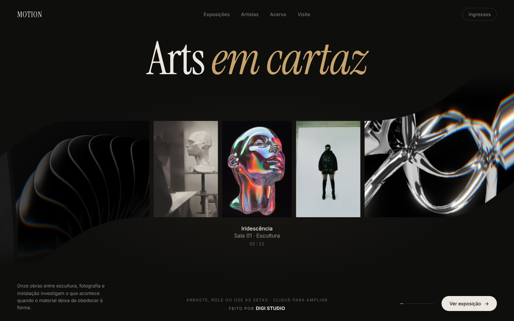

# MOTION — Hero

Tela hero de uma galeria de arte construída com React + Vite e o componente
`FlexCarousel` (WebGL via [ogl](https://github.com/oframe/ogl)): uma lente
"líquida" que curva as obras nas bordas, com dispersão cromática, legenda e
contador animados.



## Rodando

```bash
npm install
npm run dev
```

Build de produção: `npm run build` (saída em `dist/`).

## Estrutura

```
src/
  App.jsx                   # a tela hero (barra, título, carrossel, rodapé)
  App.css                   # estilos do hero
  index.css                 # tokens de cor e tipografia
  data/obras.js             # lista de obras exibidas no carrossel
  components/
    FlexCarousel.jsx        # carrossel WebGL
    FlexCarousel.css
```

## Trocando as obras

Edite `src/data/obras.js`. Cada item aceita `src`, `alt`, `title` e
`subtitle` (opcional). Para usar imagens locais, coloque-as em
`public/images/` e use `src: '/images/one.jpg'`. Imagens de outro domínio
precisam permitir CORS, porque viram texturas WebGL.

## Interação

- Arrastar, roda do mouse ou setas do teclado navegam entre as obras.
- Clique na obra central (ou Enter) para ampliar; Esc ou clique de novo fecha.
- Respeita `prefers-reduced-motion`.

As imagens de demonstração são do [Unsplash](https://unsplash.com).
